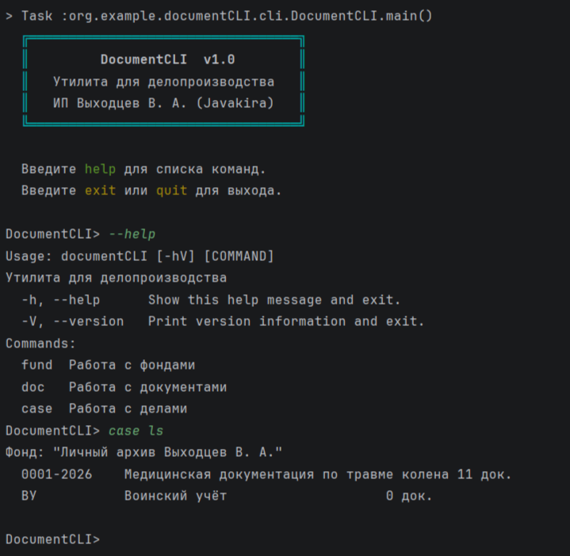

# DocumentCLI

CLI-утилита для управления фондами, делами и документами.

## Возможности

- Добавление документов в дела
- Поиск документов по названию / номеру дела
- Генерация выписок из дела для печати
- Работа со сканами документов
- Автоматическое присвоение регистрационных номеров документам

## Цель проекта

Автоматизация личного документооборота: быстрый поиск нужных бумаг и формирование выписок без ручного перебора папок.

## Стек

- Java 26
- Picocli
- JLine
- Jackson
